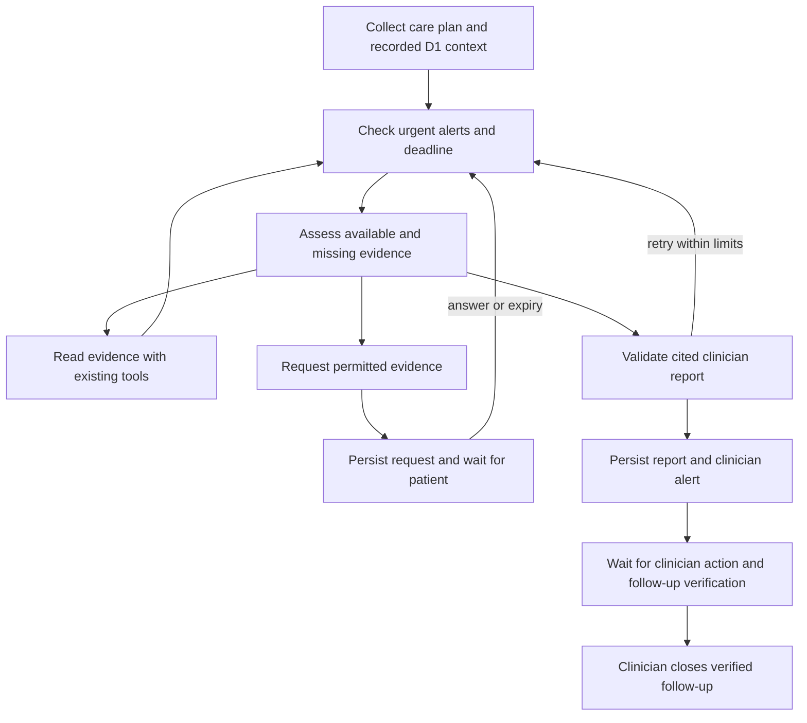

# Developer 3: LangGraph investigation

The main `/patients` investigation now runs through `app/agents/investigation_graph.py`.
The older `/v1/demo` example remains a separate demo.

## Flow



These are graph stages, not separate autonomous clinical decision makers. Urgent rules run independently.
The graph cannot diagnose, prescribe, verify follow-up or close an alert on behalf of a clinician.

## Persistence and safety

- `Investigation.state` stores messages, pending tool/request, context snapshot, workflow stage and non-tool retry count.
- The graph ends at a patient wait. The existing answer/expiry handler resumes using that checkpoint.
- The SQLite tool transaction remains the durable checkpoint. No separate LangGraph checkpointer is used:
  it would otherwise need coordination with request creation and the existing transaction recovery.
- The startup recovery and sweep use the same graph entry point, existing IDs, budgets and deadlines.
- At most eight discretionary tool calls and two patient requests; the fixed context snapshot does not initiate any
  new D1 computation. It records the current plan and up to three recent rehabilitation/movement results each.
- Required evidence reads must have persisted successful results. If the tool budget ends before those reads,
  the clinician receives an incomplete report. Missing evidence remains unknown.
- Patient photos use the existing dressing-window checks and confirmation. Investigation timeout leaves a
  valid scheduled photo request independent of the completed report.
- Report validation retains observation references and quality checks. D1 outputs are explicitly supplementary,
  include their stored IDs/timestamps, and are separate from direct patient/device facts. Demo D1 sessions are
  now stored with `simulated=true`, so that label survives into investigation context.
- Report completion creates an open clinical follow-up. The alert ledger is the source of truth for acknowledgement,
  contact, action, verification and closure. The graph does not keep a worker running while awaiting a clinician.
- Single Uvicorn worker only. Multiple processes still require durable job claims. Delivery to external services
  needs an outbox/idempotency design; database rollback cannot undo an external API request.

## See it in the existing frontend

Start the local stack with `./scripts/start-local.ps1` from the repository root.

1. Open `http://localhost:8000/agent-demo/` and run **Infection pattern**.
2. Answer patient requests. Photos can only be submitted during the allowed dressing window, with confirmation.
   The demo's dressing-window control advances the fictional clock when necessary.
3. Open the clinic section. The **Investigation workflow · langgraph** card shows milestones, context sources
   and public evidence actions. The evidence report includes uncertainty and supplementary D1 findings.
4. Acknowledge, contact the patient and record a fictional clinician action.
5. Add explicitly synthetic follow-up evidence using the demo control, select it and record the assessment.
   `needs_review` keeps the case open; a successful verification permits explicit clinician closure.

The patient app at `/app/` shows the same case's review progress on Home and Requests. It does not show
clinician reports, model messages or tool traces. `/story` and `/prototype` also show the graph's progress.

AI is in **stub mode** by default: the graph, persistence, tool guards and evidence validation are real;
model choices and report wording are deterministic demo outputs. Live-provider behavior needs separate evaluation.

### OpenRouter live demo

Keep `OPENROUTER_API_KEY` in the ignored `backend/.env`, with:

```dotenv
LLM_PROVIDER=openrouter
OPENROUTER_MODEL=poolside/laguna-s-2.1:free
LLM_ROUTE_INVESTIGATION=openrouter:poolside/laguna-s-2.1:free
```

After changing provider settings, restart the Python server so it reloads `.env`. Start the local stack with
`./scripts/start-local.ps1 -AiMode live`; its default remains `stub`. The dashboard AI selector also changes
the running service's mode. This is a global mode affecting AI features, not only the investigation.

Laguna supports tool calls but not enforced JSON output. Our adapter requests JSON in the prompt for
JSON consumers, retains JSON parsing/schema validation, and falls back on invalid output or provider failure.
Do not send real patient records to this free endpoint: its model page states that inputs/outputs may be
used for training. It is a coding model being evaluated for the fictional demo, not a clinically validated model.
The free endpoint is scheduled to end October 31, 2026; model availability should be checked before a demo.
See [OpenRouter's model details](https://openrouter.ai/poolside/laguna-s-2.1:free).

## Checks

```powershell
cd backend
./.venv/Scripts/python.exe -m pytest tests test_d3_demo.py -q
cd ../mobile
npx tsc --noEmit
npm run build:web
```
